<a href="https://gbhportfolio.vercel.app">
  <picture>
    <source media="(prefers-color-scheme: dark)" srcset="assets/header-dark.svg">
    
  </picture>
</a>

I'm an AI engineer in Chennai. I turn rough ideas into software people actually use, and I own the work end to end, from the first conversation to the release. Open to AI engineering roles, remote.

[Portfolio](https://gbhportfolio.vercel.app) · [LinkedIn](https://www.linkedin.com/in/gowthambh) · [Medium](https://medium.com/@gowthambh) · [Instagram](https://www.instagram.com/gowtham_b_h/) · gowthambh9903@gmail.com

### Pick a door

<b>I'm hiring</b>

 

- I build LLM apps, voice agents, and computer vision systems, and I ship them myself.
- At Q.DoTZ I led researchers and interns across 12 R&D initiatives.
- I built Tailrd solo and got it to 50+ users.
- Python, PyTorch, LangGraph, RAG, Flask, PostgreSQL with pgvector, Firebase, Vertex AI, Docker.

The quickest way to reach me is [LinkedIn](https://www.linkedin.com/in/gowthambh) or email. My resume is on [the portfolio](https://gbhportfolio.vercel.app).

<b>I'm building something</b>

 

I like day zero: no spec, no data, no clear path. I scope the problem with you, build the first version, and keep going until it's in people's hands. I also run [Your Space, Virtually](https://gbhportfolio.vercel.app), a small agency that builds websites, local SEO, and voice agents for businesses in several countries.

If your problem doesn't have a path yet, I'd like to hear about it.

<b>Just looking around</b>

 

I'm also a photographer, I co-founded VITC Vaazhkai (a Tamil student community of 4,000+), and I write on [Medium](https://medium.com/@gowthambh). Long term, I want to build something big in agritech.

### Problems I didn't have a path for

Click one to see what happened.

<b>Job seekers spend hours rewriting the same resume</b>

 

**What I did:** built [Tailrd](https://tailrd.web.app). It rewrites your resume for any job description, runs ATS fit checks, and writes the cover letter.

**Result:** shipped solo, 50+ users.

<b>Clinics miss calls, and patients miss appointments</b>

 

**What I did:** built a voice agent that answers the phone, books the appointment, adds it to the clinic's calendar, and calls the patient back with a reminder at the time they chose.

<b>One model couldn't identify medicinal plants in real field photos</b>

 

**What I did:** at Q.DoTZ, built the identification engine from scratch, owned the data pipeline, and combined three models instead of trusting one.

**Result:** about 30% more accurate than any single model on real field data.

<b>Nobody knew if quantum ML could classify Alzheimer's from MRI scans</b>

 

**What I did:** built a hybrid quantum-classical CNN and benchmarked it against classical CNNs.

**Result:** independent research, written up on the [portfolio](https://gbhportfolio.vercel.app).

<b>Drone images needed to stay secure on the way to the server</b>

 

**What I did:** DroMOD, real-time object detection on drones with multi-tier encryption on the images it sends.

